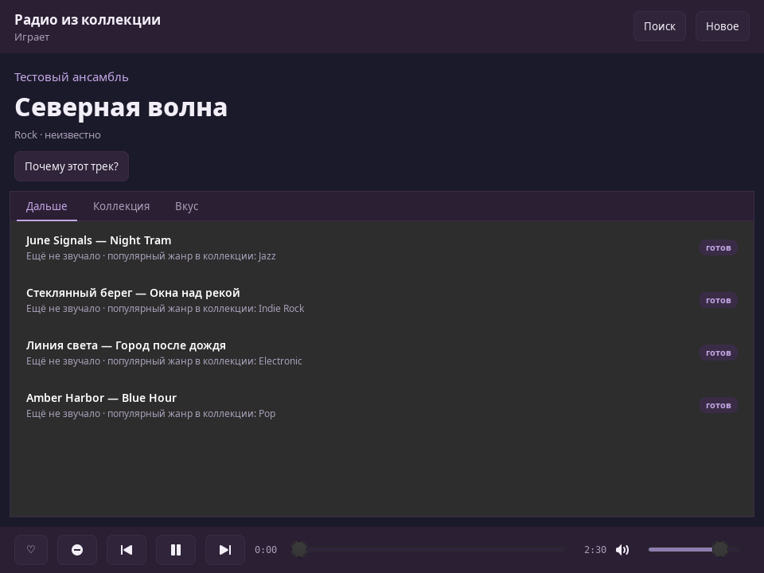
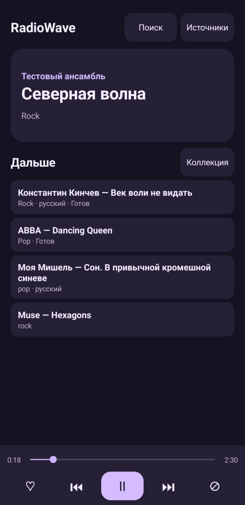

# Волна

Открываешь плеер, жмёшь «Слушать», дальше музыка идёт сама. Волна играет файлы из твоей коллекции, ищет записи через RuTor и публичный JacRed и скачивает нужные аудиофайлы по BitTorrent. Лайки, дизлайки и ранние пропуски помогают ей подбирать следующие песни.

В репозитории две версии. Плеер для Linux лежит в корне, приложение для телефона находится в [android/](android/).



## Запуск на Linux

На Ubuntu 24.04 достаточно Python, GTK, GStreamer и libtorrent. В других дистрибутивах установи те же компоненты через свой пакетный менеджер. Волна рассчитана на Python 3.12+, GTK 4.10+, GStreamer 1.0 и libtorrent 2.0.

```bash
sudo apt install git python3 python3-gi python3-libtorrent gir1.2-gtk-4.0 \
  gir1.2-gstreamer-1.0 gstreamer1.0-plugins-base gstreamer1.0-plugins-good gstreamer1.0-libav
git clone https://github.com/lliyplliuk/radio-wave.git
cd radio-wave
./run.sh
```

В «Коллекцию» можно добавить файлы, целую папку, magnet-ссылку или файл `.torrent`. Если знаешь, что хочешь услышать, введи исполнителя и название в «Поиске». «Почему этот трек?» объясняет, откуда песня взялась в волне, а во вкладке «Вкус» можно настроить, насколько учитывать жанр, язык и исполнителя.

В списке «Дальше» видно до четырёх треков. Плеер заранее скачивает до восьми. Если следующая песня ещё качается, волна ищет готовый трек в очереди и включает его сразу. При точном выборе плеер ждёт выбранный файл и сообщает, если источник недоступен.

<details>
<summary>Добавить плеер в меню приложений</summary>

Из каталога репозитория выполни:

```bash
mkdir -p "$HOME/.local/bin" "$HOME/.local/share/applications"
ln -s "$PWD/run.sh" "$HOME/.local/bin/radio-wave"
install -m 644 radio-wave.desktop "$HOME/.local/share/applications/radio-wave.desktop"
```

Для запуска из меню каталог `$HOME/.local/bin` должен быть в `PATH` графического сеанса. Если ты только что создал этот каталог на Ubuntu, выйди из сеанса и войди снова.

</details>

## Android

На телефоне нажми «Пуск», чтобы включить волну. В «Источниках» можно добавить свои записи или раздачу. Android-версия скачивает до четырёх треков вперёд. Плеер продолжает играть после сворачивания, управлять им можно из шторки и с экрана блокировки.



Для сборки нужны JDK 17 и Android SDK с платформой API 35. На телефоне нужен Android 8 или новее. Сборка поддерживает `arm64-v8a` и `x86_64`.

```bash
cd android
export ANDROID_HOME="$HOME/Android/Sdk" # Укажи свой путь к SDK.
./gradlew :app:testDebugUnitTest :app:assembleDebug
```

Готовый файл появится в `android/app/build/outputs/apk/debug/app-debug.apk` от корня репозитория. [Подробнее о сборке и установке](android/README.md).

## Где хранятся данные

Волна работает без своего сервера и не просит API-ключей. В Linux каталог и метаданные раздач лежат в `~/.local/share/radio-wave/`, история, оценки и настройки в `~/.local/state/radio-wave/`, скачанное аудио в `~/.cache/radio-wave/downloads/`. На Android приложение хранит всё в своих данных.

Если хочешь изменить пути, скопируй [`.env.example`](.env.example) в `.env`, раскомментируй нужные строки и выполни `source .env` в терминале перед запуском или сборкой.

## Проверки

На Ubuntu установи `python3-pytest` и `python3-pytest-subtests`, потом запусти из корня:

```bash
python3 -m pytest tests -q
```

Для проверок GTK нужен графический сеанс. В тестах BitTorrent используются локальные пиры.

Подробности поиска и загрузки можно посмотреть через `./run.sh --dev`. На Linux журнал пишется в `${XDG_STATE_HOME:-$HOME/.local/state}/radio-wave/playback.log`.
